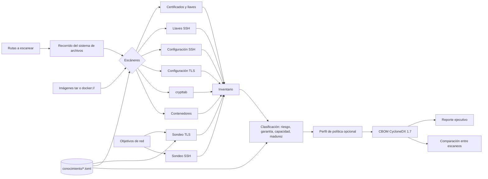

# Arquitectura de Suaya

## Integraciones 1.4

El workspace tiene seis crates. `suaya-api` conecta Axum con el motor y SQLite; valida tokens y autoriza por propietario. La configuración y los objetivos son administrados fuera de HTTP. `macos/SuayaApp.swift` invoca el motor empaquetado `suaya-engine` mediante argumentos separados, sin shell, y lee su CBOM y HTML. `scripts/automatizar.py` ejecuta el mismo motor secuencialmente. No se conserva el conjunto de crates simulados de 1.3.

La API y la CLI agregan `suaya:estado` al CBOM; un resultado parcial no representa cobertura completa. Las operaciones con credenciales verifican TLS. La firma v2 autentica también la fecha declarada. Consulte `cierre-1.4.md` para controles y límites operativos.

## Flujo general

## Componentes

### `suaya-core`

- **`modelo`**: el `Activo` y sus `Detalles` (algoritmo, certificado, material o protocolo), sus contextos de uso, ubicaciones y relaciones. Es independiente de CycloneDX.
- **`conocimiento`**: carga e indexa `algoritmos.toml` y `madurez.toml` (incrustados al compilar o desde un directorio). Valida que no haya identificadores, OIDs ni alias duplicados.
- **`politica`**: carga los perfiles de `conocimiento/perfiles/` (incrustados o desde un archivo) y asigna a cada activo su estado de cumplimiento y su fecha límite.
- **`idioma`**: idioma del proceso (o de un hilo), la macro `t!` para el texto propio de la interfaz y `traducir`, que pasa el texto de los hallazgos por el catálogo `conocimiento/traducciones/en.toml` (plantillas con marcadores, de la más específica a la más general, que traducen también los valores capturados).
- **`clasificacion`**: asigna riesgo, acción y prioridad. Primero clasifica los algoritmos; después, certificados, llaves y protocolos heredan el riesgo más grave de los algoritmos con los que se relacionan, salvo que el escáner haya fijado uno (por ejemplo, una configuración TLS cuyo riesgo depende de la combinación de versiones y grupos).

### `suaya-escaneo`

Cada escáner implementa el rasgo `Escaner`. El recorrido entrega a cada escáner el contenido del archivo, su ruta visible y una **ruta estable** (relativa a la raíz escaneada) con la que se derivan las referencias. Así, dos escaneos del mismo sistema producen las mismas referencias aunque se lancen desde directorios distintos.

Las imágenes de contenedor (`--imagen`) pasan por `AnalizadorImagen`, que recibe cada capa como un flujo de lectura, de modo que el archivo tar local y la descarga desde un registro comparten el mismo código. El archivo tar se lee en dos pasadas: la primera obtiene el manifiesto (`manifest.json` de `docker save` o `index.json` de OCI) y el orden de las capas; la segunda descomprime cada capa en memoria (gzip o zstd) y entrega sus archivos a los mismos escáneres, con ubicaciones como `imagen.tar@capa2:/etc/ssl/...`. Los archivos `.wh.` de cada capa permiten saber qué se borró después. Hay límites de entradas y de datos descomprimidos contra bombas de compresión, y nada se escribe en disco.

El escáner de código (`codigo`) limpia los comentarios con un analizador léxico por lenguaje y aplica las reglas de `codigo.toml`, compiladas una sola vez y compartidas entre escaneos. El de bibliotecas (`bibliotecas`) lee manifiestos y archivos de bloqueo, y busca cadenas de versión en binarios con expresiones sobre bytes; los archivos mayores que el límite general solo se leen si son bibliotecas criptográficas conocidas o, con `--binarios`, ejecutables (hasta 512 MiB). `importar` reconstruye un CBOM CycloneDX ajeno como activos de Suaya.

Al final del recorrido, las configuraciones TLS que apuntan a un certificado por ruta se enlazan con el certificado hallado, que recibe el contexto de uso del servidor.

#### Rendimiento

- **Recorrido y análisis separados.** Primero se recorre el sistema de archivos y se reúne la lista de tareas (solo rutas y metadatos); después un conjunto de hilos (`--hilos`, `std::thread::scope`) toma tareas de un contador atómico, lee y analiza cada archivo. Cada resultado conserva el índice de su tarea y al final se unen en el orden del recorrido, así que el inventario no depende del número de hilos ni del orden en que terminan. Una prueba lo comprueba con uno, cuatro y todos los núcleos.
- **Una sola pasada por archivo.** Antes de entregar un archivo a los escáneres, `Archivo::contiene` consulta un autómata Aho-Corasick con todas las marcas que los escáneres buscan (`-----BEGIN`, `ssl_protocols`, `PrivateKey`, nombres de API criptográficas...). El autómata se construye una vez por proceso y recorre el contenido una vez; cada escáner pregunta después por sus marcas en tiempo constante.
- **Binarios grandes por bloques.** Con `--binarios`, los archivos mayores que el límite general se leen en bloques de 8 MiB con un traslape de 64 KiB, suficiente para que ninguna cadena de versión quede partida entre dos bloques. La memoria queda acotada aunque el binario mida cientos de MiB.
- **Datos compilados una vez.** Las reglas de código, las expresiones de versión de bibliotecas y el catálogo de traducción se compilan en el primer uso y se comparten entre hilos.

### `suaya-red`

- **TLS**: construye sus propios `ClientHello` y lee la respuesta (`HelloRetryRequest`, `ServerHello` o alerta). Prueba cada grupo de la base de conocimiento por separado, ofrece todos los grupos en dos órdenes opuestos para conocer la preferencia del servidor y prueba TLS 1.2, 1.1, 1.0 y SSL 3.0 con saludos clásicos. La cadena de certificados se obtiene con un saludo completo de rustls (proveedor aws-lc-rs, capaz de negociar X25519MLKEM768) y un verificador que no confía en nada: solo lee los certificados.
- **SSH**: intercambia identificaciones y lee el primer paquete binario, el `KEXINIT`.
- **STARTTLS** (`starttls`): preámbulos mínimos de SMTP, IMAP, POP3, LDAP, PostgreSQL y MySQL; leen la respuesta byte a byte para no consumir nada del saludo TLS que sigue.
- Los certificados obtenidos se analizan con las mismas reglas que los de archivos (`suaya_escaneo::api`).
- **HTTP**: `http` es un cliente GET mínimo sobre rustls que entrega el cuerpo como flujo (`Content-Length`, `chunked` o hasta el cierre), verifica el servidor con una autoridad dada o con las del sistema, admite certificado de cliente y atraviesa un proxy `HTTPS_PROXY` con `CONNECT`.
- **Registros**: `registro` interpreta la referencia como Docker, resuelve el desafío `Bearer` o `Basic`, elige la plataforma del índice, sigue redirecciones sin reenviar la autorización a otro servidor y verifica cada resumen mientras la capa se analiza.
- **Kubernetes**: `kubernetes` resuelve el kubeconfig con `yaml-rust2`, ejecuta complementos `exec` si los hay, pagina las listas de la API (`limit` y `continue`) y entrega el PEM de cada Secret al mismo analizador que los archivos.
- El sondeo solo actúa sobre objetivos explícitos; no hay descubrimiento de servicios por rangos.

### `suaya-cbom`

- **`exportar`**: traduce el inventario a CycloneDX 1.7 (y, con perfil, a una atestación CDXA) (`cryptoProperties`, `evidence.occurrences`, `relatedCryptographicAssets`, `dependencies`) y agrega la clasificación como propiedades `suaya:`.
- **`lectura`**: interpreta un CBOM de Suaya.
- **`reporte`**: calcula un modelo único del reporte y lo presenta en Markdown o en HTML autocontenido.
- **`firma`**: llaves, firma y verificación compuestas ML-DSA-65 y Ed25519 con AWS-LC.
- **`comparar`**: detecta activos nuevos, eliminados y cambios de riesgo o prioridad.

### `suaya-cli`

Binario `suaya` con las órdenes `escanear`, `sondear`, `kubernetes`, `importar`, `reporte`, `comparar`, `perfiles`, `llaves`, `firmar`, `verificar` y `conocimiento`, y la opción global `--idioma`.

## Referencias deterministas

| Activo | Referencia |
|---|---|
| Algoritmo | `algoritmo:<id>` o `algoritmo:<id>-<tamaño>` (RSA, DSA) |
| Algoritmo no reconocido | `algoritmo:desconocido:<nombre u OID>` |
| Certificado | `certificado:<huella SHA-256 del TBSCertificate, 16 hex>` |
| Llave pública | `llave:<huella SHA-256 de la llave, 16 hex>` |
| Llave privada | `llave:<hash de ruta estable y línea, 16 hex>` |
| Protocolo (archivo) | `protocolo:<tls|ssh>:<hash de ruta estable>` |
| Protocolo (red) | `protocolo:<tls|ssh>:<hash de tls://host:puerto>` |
| TLS inseguro en código | `protocolo:tls:codigo:<hash de ruta estable>` |
| Biblioteca | `biblioteca:<id>:<versión>` |
| Activo importado | `<tipo>:importado:<hash de archivo, referencia original y nombre>` (los algoritmos conservan `algoritmo:<id>`) |

Las llaves públicas idénticas en archivos distintos se fusionan en un solo activo con varias ubicaciones.
